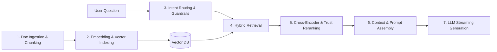
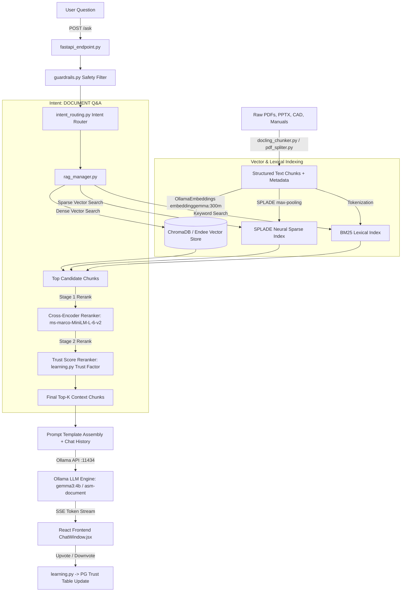

# ASM AI Assistant — RAG Application Complete Technical & Functional Documentation

> **System Overview:** On-Premise Retrieval-Augmented Generation (RAG) & Industrial Intelligence Platform for Smart Manufacturing  
> **Tech Stack:** Python (FastAPI/Flask), React + Vite, Ollama (Gemma 3), ChromaDB / Endee, QuestDB, PostgreSQL, LangGraph, Kafka, Nginx  

---

## 1. System Overview & Core Capabilities

The **ASM AI Assistant** is an enterprise-grade, privacy-first, on-premise RAG platform engineered specifically for smart manufacturing, operator support, failure analysis, and machine log analytics. It operates 100% offline (air-gapped capable) to guarantee data privacy, low latency, and zero dependency on external cloud services.

---

## 2. Fundamental Concept: How a RAG Pipeline Works

### 2.1 What is RAG?
**Retrieval-Augmented Generation (RAG)** is an AI architectural pattern designed to solve the primary limitations of large language models (LLMs): **hallucinations**, **outdated knowledge**, and **lack of access to private enterprise data**.

Instead of relying solely on the static weights of a pre-trained LLM, a RAG system dynamically retrieves relevant information from external domain-specific knowledge bases (manuals, databases, logs) and feeds that information to the LLM as context alongside the user's question.

### 2.2 Standard 7-Step RAG Workflow



1. **Document Ingestion & Chunking**: Large documents (PDFs, PPTXs, Manuals) are parsed, cleaned, and split into smaller semantic units ("chunks").
2. **Embedding & Indexing**: Text chunks are converted into numerical vector representations (embeddings) using an embedding model and stored in a vector database.
3. **Query Guardrails & Routing**: The user's input is validated for safety and classified to determine if it requires document search, SQL database lookups, or direct casual response.
4. **Information Retrieval**: The system converts the user's question into a query vector and searches the vector database (plus keyword indices) to find the most relevant chunks.
5. **Re-Ranking & Filtering**: Candidate chunks are re-evaluated using specialized cross-encoder models and feedback weights to sort them by true semantic relevance.
6. **Prompt Assembly**: The highest-scoring text chunks are injected into a structured prompt template along with historical conversation context and source citation metadata.
7. **LLM Generation & Token Streaming**: The LLM reads the context-enriched prompt and generates a factually grounded answer, streaming tokens back to the user in real time.

---

## 3. Deep-Dive: How RAG is Implemented in THIS Application

This application implements an advanced, industrial-grade **Hybrid Multi-Vector RAG Pipeline** with autonomous agents, continuous learning, and multi-stage reranking. Below is a detailed walkthrough of each stage in the codebase:



---

### Step 1: Multimodal Document Processing & Structural Chunking
- **Files**: `src/docling_chunker.py`, `src/pdf_spliter.py`, `src/chunker_CAD.py`, `src/process_pptx.py`
- **How it works**:
  - Instead of naïve character-count splitting, the system uses **Docling-based hierarchical chunking**.
  - It preserves document layout structure: section headings, table markdown formatting, image references, and page numbers.
  - CAD drawings (`.dwg`/`.dxf`) and PPTX presentations are processed via dedicated parsers to extract component lists and slide notes.

---

### Step 2: Triple-Representation Vector & Sparse Indexing
- **Files**: `src/rag_manager.py`, `src/chroma_connector.py`, `src/endee_connector.py`, `src/splade_cache.py`
- **How it works**:
  - **Dense Vectors**: Chunks are embedded using `OllamaEmbeddings` with `embeddinggemma:300m` (300M parameter vision/text embedding model) into **ChromaDB** or **Endee Vector DB**.
  - **Neural Sparse Vectors (SPLADE)**: Uses `SPLADERetriever` with max-pooling activations `max(log(1 + relu(logits)))` over token logits to represent documents in high-dimensional term space.
  - **Lexical Index**: `BM25Okapi` indexes tokenized chunk texts to catch exact serial numbers, error codes, and technical jargon.

---

### Step 3: Query Interception, Guardrails & Intent Routing
- **Files**: `src/guardrails.py`, `src/intent_routing.py`, `src/fastapi_endpoint.py`
- **How it works**:
  - **Guardrails**: `check_query_safety()` scans input against regex and semantic safety filters to reject dangerous commands or prompt injection attacks.
  - **Intent Classification**: `classify_intent()` routes the query into:
    - `DOCUMENT`: Triggers full hybrid document RAG.
    - `FA_REPORT`: Routes to the LangGraph Failure Analysis Agent ([fa_agent.py](file:///c:/Users/ASM9017/Downloads/GitHub/ai-assistant/src/fa_agent.py)).
    - `LOG_QUERY`: Routes to the QuestDB Time-Series Diagnostic Agent ([questdb_agent.py](file:///c:/Users/ASM9017/Downloads/GitHub/ai-assistant/src/questdb_agent.py)).
    - `BOM_QUERY`: Routes to the BOM relational planner ([bom_query_planner.py](file:///c:/Users/ASM9017/Downloads/GitHub/ai-assistant/src/bom_query_planner.py)).
    - `CASUAL` / `GENERAL`: Directly generates conversational response without document retrieval.

---

### Step 4: Hybrid Ensemble Retrieval
- **File**: `src/rag_manager.py`
- **How it works**:
  - When a `DOCUMENT` query arrives, the system executes retrieval across all three index representations simultaneously:
    $$\text{Candidates} = \text{DenseRetriever}(Q, k) \cup \text{SPLADERetriever}(Q, k) \cup \text{BM25Retriever}(Q, k)$$
  - Chunks retrieved across methods are merged and deduplicated by unique hash/chunk IDs.

---

### Step 5: Two-Stage Re-Ranking Engine
- **Files**: `src/rag_manager.py`, `src/model_loader.py`, `src/learning.py`
- **Stage 1 (Cross-Encoder Semantic Alignment)**:
  - Uses `ms-marco-MiniLM-L-6-v2` loaded via `ModelLoader` to compute deep cross-attention scores between the query and each candidate chunk text:
    $$Score_{\text{cross}} = \text{CrossEncoder}(Q, Chunk_i)$$
- **Stage 2 (Feedback-Based Trust Factor Adjustment)**:
  - Integrates the continuous learning engine ([learning.py](file:///c:/Users/ASM9017/Downloads/GitHub/ai-assistant/src/learning.py)).
  - Queries PostgreSQL for historical user votes (upvotes/downvotes) associated with each chunk:
    $$Score_{\text{final}} = Score_{\text{cross}} \times Trust\_Factor(Chunk_i)$$
  - Chunks with high user satisfaction gain priority, while downvoted or problematic chunks are automatically demoted.

---

### Step 6: Context Assembly & Security Verification
- **Files**: `src/fastapi_endpoint.py`, `src/chat_history_manager.py`
- **How it works**:
  - Checks user Role-Based Access Control (RBAC) to ensure the user is authorized for the chunk's station ID and category.
  - Retrieves the last 5 conversation exchanges from PostgreSQL (with MongoDB fallback) via [chat_history_manager.py](file:///c:/Users/ASM9017/Downloads/GitHub/ai-assistant/src/chat_history_manager.py).
  - Formats the augmented prompt:
    ```text
    === System Instructions ===
    You are the ASM AI Assistant. Answer strictly using the context below.
    
    === Previous Conversation ===
    {chat_history_5_exchanges}
    
    === Retrieved Reference Chunks ===
    [Doc: Manual_SN400.pdf | Page 42 | Station: ST-04]
    {chunk_text_1}
    
    === User Question ===
    {user_question}
    ```

---

### Step 7: Real-Time SSE Token Streaming & Provenance Logging
- **Files**: `src/fastapi_endpoint.py`, `frontend/src/components/ChatWindow.jsx`, `src/security_logging.py`
- **How it works**:
  - The assembled prompt is sent via REST to local Ollama API (`http://localhost:11434/api/generate`) running `gemma3:4b` or `asm-document`.
  - Tokens are streamed back to the frontend in real-time using **Server-Sent Events (SSE)**.
  - The frontend renders markdown, code blocks, and source citations with page numbers and document preview links.
  - **Audit Provenance**: Every response writes a provenance record to PostgreSQL detailing prompt tokens, retrieved chunk IDs, confidence scores, and user ID for enterprise auditing.

---

## 4. Operational Components & Agent Extensions

| Component / Subsystem | Primary File(s) | Description |
| :--- | :--- | :--- |
| **Failure Analysis Agent** | `src/fa_agent.py`, `src/fa_pptx_generator.py` | LangGraph state machine that collects failure diagnostics and exports `.pptx` reports. |
| **QuestDB MCP Server** | `src/mcp_questdb_server.py`, `src/questdb_agent.py` | 30+ diagnostic tools for time-series CNC machine logs, anomaly detection, and health scoring. |
| **BOM Engine** | `src/bom_query_planner.py`, `src/bom_retriever.py` | Relational part lookup and assembly hierarchy resolution. |
| **Feedback Learning** | `src/learning.py` | Batch job that updates PostgreSQL chunk trust scores based on user thumbs up/down votes. |
| **File Auth Proxy** | `file-auth` container, Nginx config | Verifies backend-signed cookies for raw PDF and image previews. |

---

## 5. System Databases & Persistence Layers

1. **PostgreSQL 16**: Primary relational database storing user accounts, RBAC policies, chat session metadata, provenance logs, BOM hierarchies, and chunk trust scores.
2. **ChromaDB / Endee**: Vector stores holding chunk embeddings for semantic retrieval.
3. **QuestDB**: High-performance time-series database storing millions of raw machine events, cycle logs, and sensor readings.
4. **MongoDB (Fallback / Legacy)**: Document store for legacy chat history and unstructured logs.
5. **Kafka**: Distributed event broker streaming live machine logs into QuestDB.

---

## 6. How to Run the Application

### 6.1 Requirements
- Python 3.10 – 3.13
- Node.js & npm
- Ollama (`ollama pull gemma3:4b`, `ollama pull embeddinggemma:300m`)
- Docker / Podman (for PostgreSQL, QuestDB, ChromaDB, Kafka)

### 6.2 Service Launching
- **Windows Start Script**: `start-ai-assistant.ps1` or `start-ai-assistant.bat`
- **Backend API Server**: `python src/fastapi_endpoint.py` (Port 5000)
- **Frontend Dev Server**: `npm run dev` in `/frontend` (Port 5173)
- **Ollama LLM Engine**: `ollama serve` (Port 11434)

---
*Generated automatically by Antigravity AI Assistant.*
